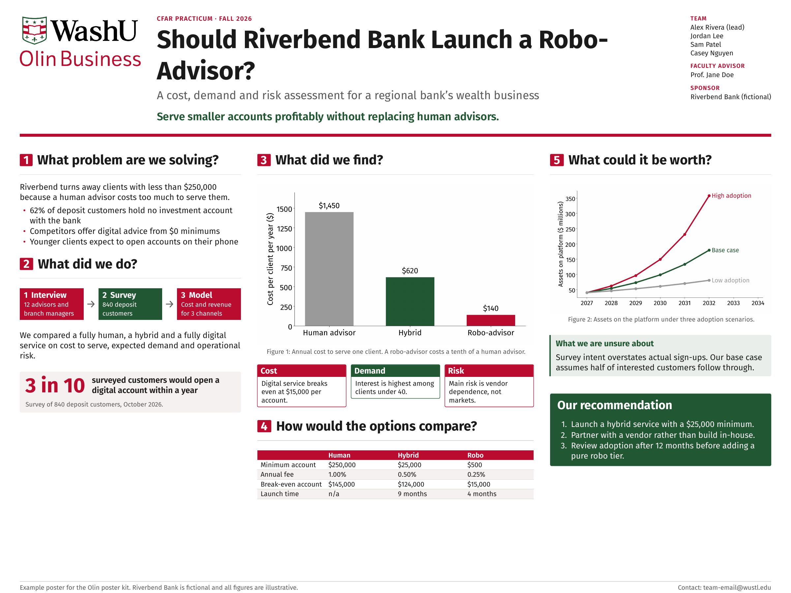

# WashU Olin Poster Kit

A template for 48 × 36 inch landscape research posters with WashU Olin branding. You write the poster with Claude and compile it on [typst.app](https://typst.app), a free web editor. Nothing needs to be installed.



The example poster is for a fictional client, and all of its numbers are made up.

## What is in the kit

| File | What it is |
|---|---|
| `main.typ` | The poster content. This is the only file you edit. |
| `olin-poster.typ` | The layout, colors and building blocks. Do not edit. |
| `PROMPT.md` | The instructions to paste into Claude. |
| `logos/` | WashU Olin Business logos. |
| `fonts/` | Fira Sans, so the poster looks the same everywhere. |
| `figures/` | Figures for the example poster. Put yours here. |
| `example-poster.pdf` | The example poster as printed. |

## Steps

### 1. Get the kit

On this page, click the green **Code** button, then **Download ZIP**, and unzip it.

### 2. Create a typst.app project

1. Sign up at [typst.app](https://typst.app) (free).
2. Click **Empty document**, name it after your project.
3. In the left panel, open the **Explore files** view and upload the files from the kit, keeping the folders: `main.typ`, `olin-poster.typ`, and the `logos/`, `fonts/` and `figures/` folders. You can drag folders in.
4. Delete the `main.typ` that typst.app created if it asks, and keep the one from the kit.
5. The example poster appears on the right. If it does, everything works.

One team member creates the project and shares it with the others (**Share** button, top right), so everyone edits the same poster.

### 3. Write the poster with Claude

1. Open a new chat at [claude.ai](https://claude.ai).
2. Paste the text from `PROMPT.md`.
3. Attach `main.typ`, `olin-poster.typ`, and your project material: report, slides, figures.
4. Answer Claude's questions and agree on the outline.
5. Claude replies with a complete `main.typ`. In typst.app, select all the text of `main.typ`, paste Claude's version over it, and look at the preview.

To change something, tell Claude what to change ("shorten section 2", "swap columns 2 and 3", "the table is too wide"). Each time, paste the complete new `main.typ` into typst.app.

### 4. Add your figures

- Upload them to the `figures/` folder in typst.app and tell Claude their exact file names.
- Use PNG at 300 dpi or SVG. A figure for a third of the poster should be about 4,000 pixels wide; a screenshot of a small chart will print blurry.
- Make chart fonts large. In Excel, set axis and label text to 20 pt or more before exporting. In Python, see `figures/make-figures.py`.
- Charts made in Excel: right-click the chart, **Save as Picture**, choose PNG or SVG.

### 5. When something goes wrong

- **Red error in typst.app.** Copy the error message and send it to Claude with "fix this".
- **A second page appears.** The poster is too long. Ask Claude to cut text, not to shrink fonts.
- **A figure does not appear.** The file name in `main.typ` must match the uploaded file exactly, including upper and lower case.
- **Text turns into math (italic, no spaces).** A `$` sign in the text needs to be written `\$`.

### 6. Check and export

Before exporting, check that:

- the poster fits on one page and has no large empty areas,
- every name is spelled correctly and the sponsor approved what is shown,
- every figure is readable when you zoom the preview to 100%,
- there are no `[TODO]` marks left.

Then click the **Export** (download) button above the preview and choose **PDF**. That file goes to the printer.

## Optional: compile on your own computer

Install [Typst](https://github.com/typst/typst#installation), then in the kit folder run:

```
typst watch --font-path fonts main.typ
```

It writes `main.pdf` and updates it whenever `main.typ` changes.
